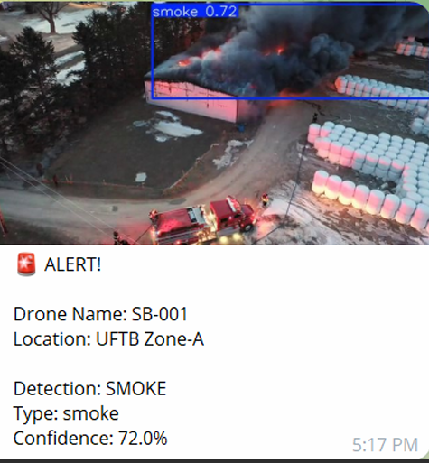
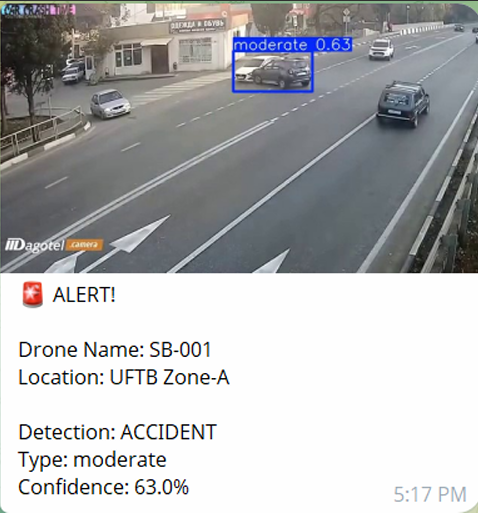
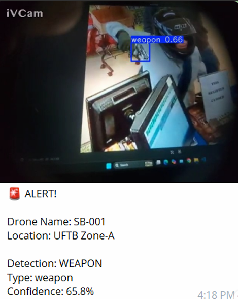
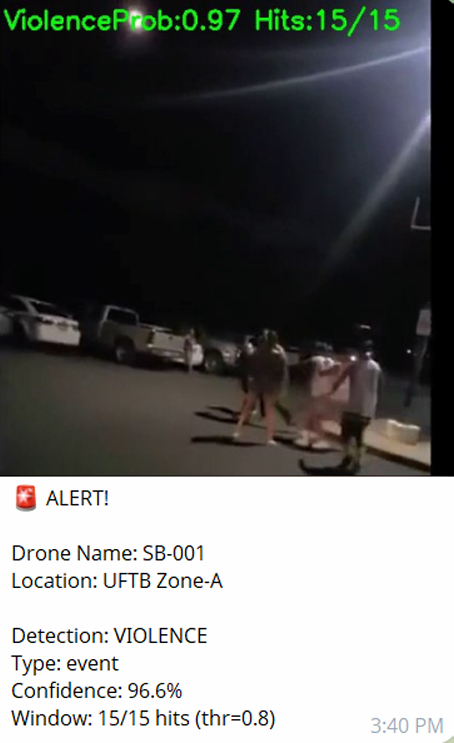

<div align="center">


<br/><br/>

```
  ██████╗ ██████╗  ██████╗ ███╗   ██╗███████╗
  ██╔══██╗██╔══██╗██╔═══██╗████╗  ██║██╔════╝
  ██║  ██║██████╔╝██║   ██║██╔██╗ ██║█████╗  
  ██║  ██║██╔══██╗██║   ██║██║╚██╗██║██╔══╝  
  ██████╔╝██║  ██║╚██████╔╝██║ ╚████║███████╗
  ╚═════╝ ╚═╝  ╚═╝ ╚═════╝ ╚═╝  ╚═══╝╚══════╝
  ███████╗██╗   ██╗██████╗ ██╗   ██╗███████╗██╗██╗      ██╗      █████╗ ███╗   ██╗ ██████╗███████╗
  ██╔════╝██║   ██║██╔══██╗██║   ██║██╔════╝██║██║      ██║     ██╔══██╗████╗  ██║██╔════╝██╔════╝
  ███████╗██║   ██║██████╔╝██║   ██║█████╗  ██║██║      ██║     ███████║██╔██╗ ██║██║     █████╗  
  ╚════██║██║   ██║██╔══██╗╚██╗ ██╔╝██╔══╝  ██║██║      ██║     ██╔══██║██║╚██╗██║██║     ██╔══╝  
  ███████║╚██████╔╝██║  ██║ ╚████╔╝ ███████╗██║███████╗ ███████╗██║  ██║██║ ╚████║╚██████╗███████╗
  ╚══════╝ ╚═════╝ ╚═╝  ╚═╝  ╚═══╝  ╚══════╝╚═╝╚══════╝ ╚══════╝╚═╝  ╚═╝╚═╝  ╚═══╝ ╚═════╝╚══════╝
```

# 🚁 AI-Driven Autonomous Aerial Surveillance System

### *Real-Time Multi-Threat Detection — Powered by YOLOv11 + Edge AI on UAV*

<br/>

> **An intelligent drone-based surveillance system that uses deep learning and edge computing**
> **to automatically detect fire, accidents, weapons, and violent activities in real time.**
> Runs AI models on a Raspberry Pi edge device mounted on a UAV,
> and sends instant alerts through Telegram when a threat is detected.

<br/>

[](https://github.com/naimurhamim)
[](#)
[](#license)
[](#)

</div>

---

## 🎬 Demo Video

<div align="center">

[](https://youtu.be/gsKDPxmqpNA)

**▶ [Watch Full Demo on YouTube](https://youtu.be/gsKDPxmqpNA)**

</div>

---

## 📸 Alert Notification Examples

When the system detects a threat event, it automatically sends an alert message to authorized users through a Telegram Bot.
Each alert contains the **type of detected threat** and an **evidence image captured from the drone camera**.

---

### 🔥 1. Fire and Smoke Detection Alert



> The system detects **fire and smoke** in aerial footage in real time. Once confirmed across multiple frames,
> a Telegram alert is triggered immediately containing the threat type and an evidence frame captured from the drone camera.

---

### 💥 2. Accident Detection Alert



> **Traffic accidents** are detected from aerial view using YOLO-based object detection.
> The alert is sent with a timestamped image of the incident for rapid emergency response.

---

### ⚔️ 3. Weapon Detection Alert



> The system identifies **weapons** in live drone footage and immediately notifies authorized personnel
> via Telegram with the captured evidence frame.

---

### 🥊 4. Violence Detection Alert



> A **CNN-based classifier** identifies violent activities from video frames. After temporal validation
> across multiple frames to reduce false positives, an alert with evidence is dispatched via Telegram.

---

## ✨ Features

| Feature | Description |
|---|---|
| 🚁 **UAV-Based Surveillance** | Aerial monitoring with real-time video capture from drone camera |
| 🔥 **Fire & Smoke Detection** | YOLO-based detection of fire and smoke from aerial footage |
| 💥 **Accident Detection** | Identifies traffic accidents in real time from drone view |
| ⚔️ **Weapon Detection** | Detects weapons using YOLO object detection model |
| 🥊 **Violence Detection** | CNN-based classifier for violent activity recognition |
| 🧠 **Edge AI Processing** | On-device inference via Raspberry Pi — no cloud dependency |
| 📨 **Telegram Bot Alerts** | Instant real-time alerts with evidence image to authorized users |
| 🔄 **Temporal Validation** | Multi-frame verification pipeline to reduce false positive alerts |
| 🖼️ **Evidence Capture** | Automatically saves threat frames as evidence in `data/captures/` |
| ⚡ **Lightweight Models** | Optimized deep learning models suitable for edge deployment |
| 🧩 **Modular Pipeline** | Each threat detector is independently pluggable and configurable |

---

## 🛠️ Tech Stack

| Component | Technology |
|---|---|
| Object Detection | YOLOv11 (Ultralytics) |
| Violence Classification | CNN (PyTorch) |
| Edge Computing | Raspberry Pi |
| Video Processing | OpenCV 4.x |
| Alert System | Telegram Bot API |
| UAV Platform | Drone with Camera Module |
| ML Framework | PyTorch |
| Language | Python 3.10 |

---

## 📁 Project Structure

```
DRONE_SURVEILLANCE_AI/
│
├── app.py                         # Main application entry point
├── requirements.txt               # Python dependencies
├── .gitignore
│
├── 📁 data/
│   ├── 📁 alert/                  # Sample alert images (Telegram notifications)
│   └── 📁 captures/               # Evidence frames captured during threat events
│
├── 📁 detectors/                  # Threat detector modules (fire, weapon, violence, accident)
├── 📁 models/                     # Trained model weights
├── 📁 tools/                      # Utility scripts and helpers
├── 📁 utils/                      # Shared utility functions
├── 📁 figures/                    # Architecture diagrams and figures
│
├── convert_weapon_to_one_class.py # Dataset conversion script
├── extract_frames.py              # Frame extraction utility
├── fix_names.py                   # Dataset label fixer
├── get_chat_id.py                 # Telegram chat ID retrieval tool
├── make_roc_violence.py           # ROC curve generation for violence model
├── split_videos.py                # Video splitting utility
├── train_violence_cls.py          # Violence CNN training script
├── violence_event.py              # Violence event handler
│
└── Dataset_ref.txt                # Dataset references and sources
```

---

## 🚀 Getting Started

### Prerequisites

- Python **3.10+**
- Raspberry Pi (or Linux machine for testing)
- Drone with camera module
- Telegram Bot Token (for alerts)
- NVIDIA GPU (optional, for faster training)

### 1. Clone the Repository

```bash
git clone https://github.com/naimurhamim/drone-surveillance-ai.git
cd drone-surveillance-ai
```

### 2. Create Virtual Environment

```bash
python -m venv venv

# Linux / Mac
source venv/bin/activate

# Windows
venv\Scripts\activate
```

### 3. Install Dependencies

```bash
pip install -r requirements.txt
```

### 4. Configure Telegram Bot

```bash
# Get your Telegram chat ID
python get_chat_id.py
```

> Set your **Bot Token** and **Chat ID** in the configuration before running the app.

### 5. Run the App

```bash
python app.py
```

---

## ⚙️ How It Works

```
Drone Camera → Live Video Feed
        ↓
Frame Extraction — real-time frame capture
        ↓
YOLO Detection → Fire / Smoke / Accident / Weapon
        ↓
CNN Classifier → Violence Detection
        ↓
Temporal Validation → Multi-frame confirmation (reduce false positives)
        ↓
Evidence Capture → Save threat frame to data/captures/
        ↓
Telegram Bot Alert → Send threat type + evidence image to authorized users
```

---

## 🧠 Model Training

### Violence Detection (CNN)

```bash
python train_violence_cls.py
```

### YOLO-Based Detectors

> Refer to `Dataset_ref.txt` for dataset sources used for fire, weapon, and accident detection models.

---

## 📊 System Architecture

The system consists of the following components:

**1. Drone Platform** — UAV equipped with Raspberry Pi and camera module.

**2. Video Capture** — Real-time video frames captured from drone camera.

**3. Threat Detection Models**
- YOLO-based object detection for Fire / Smoke, Accidents, and Weapons
- CNN-based classifier for violence detection

**4. Temporal Validation** — Multiple frame verification to reduce false positives.

**5. Alert System** — Confirmed threat events trigger Telegram Bot notifications with evidence frames.

---

## 🎥 Demo Videos

Due to GitHub file size limitations, demonstration videos are provided via Google Drive.

**📂 [Demo Video Folder — Google Drive](https://drive.google.com/drive/folders/1dIA9ZqcjGgwMMgntgV2ZicAMQnGI7Y8r)**

| File | Description |
|---|---|
| `Drone_Fly.mp4` | Demonstration of drone flight and aerial capture |
| `model_work.mp4` | Demonstration of AI-based threat detection in action |

---

## 📦 requirements.txt

```txt
ultralytics>=8.0.0
opencv-python>=4.10.0
torch>=2.0.0
torchvision>=0.15.0
numpy>=1.26.0
Pillow>=10.0.0
python-telegram-bot>=20.0
python-dotenv>=1.0.0
```

---

## 📋 Datasets

Due to size limitations, datasets are **not included** in this repository.

The datasets used include:

- Fire and smoke detection dataset
- Weapon detection dataset
- Violence detection dataset
- Accident detection dataset

> All dataset references and sources are listed in `Dataset_ref.txt`

---

## 🤝 Contributing

1. Fork the repo
2. Create your feature branch: `git checkout -b feature/AmazingFeature`
3. Commit: `git commit -m 'Add AmazingFeature'`
4. Push: `git push origin feature/AmazingFeature`
5. Open a Pull Request

---

## 📄 License

Licensed under the **MIT License** — see [LICENSE](LICENSE) for details.

---

<div align="center">

## 👨‍💻 Authors

**Anil Mali**


📧 **Corresponding Author:** 
smartanilmali234@gmail.com

Artificial Intelligence And Data Science|Aspiring AI/ML Engineer

[](https://github.com/smartanilmali234-art)

---

*Built with ❤️ for Public Safety & Smart City Surveillance*

⭐ **If you found this project helpful, please give it a star!** ⭐

</div>
